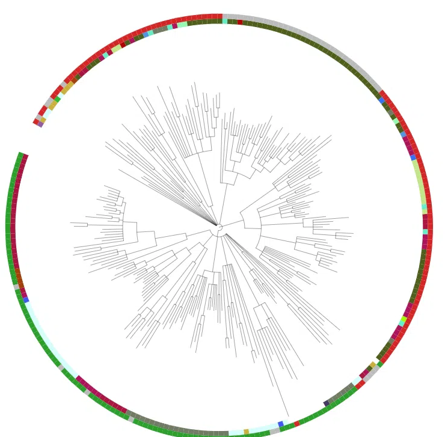

# Phylogeny of prokaryotic Argonaute proteins

Mini-project for the *Microbial Omics: phylogenetic analysis* course.

Eukaryotes use Argonaute (AGO) proteins for RNA interference. Bacteria and archaea have no classical
RNAi, but many carry distant homologues, the **prokaryotic Argonautes (pAgo)**, that are guided by short DNA
or RNA and mostly defend the cell against plasmids and phages. This project builds a phylogeny of
pAgo and asks where they occur, whether they keep their catalytic site, and whether they moved between lineages.

## Aim, hypothesis, objectives

- **Aim:** reconstruct the evolution of prokaryotic Argonaute proteins and ask whether their activity and distribution follow phylogeny.
- **Hypothesis:** loss of the catalytic tetrad happened in whole clades, and the few phylum mismatches reflect horizontal gene transfer (HGT).
- **Objectives:** (1) collect pAgo sequences from Bacteria and Archaea; (2) build a maximum-likelihood tree; (3) classify long/short pAgo and check the DEDX tetrad; (4) flag candidate HGT by comparing the tree with taxonomy.

## Main results



*Circular ML tree of 251 pAgo. Inner ring: phylum. Outer ring: catalytic tetrad (green = active, red = inactive, grey = no region).*

| Result | Value |
|---|---|
| Sequences in the tree | 251 (taxonomy available for 242) |
| Phyla | 18 (Bacteria and Archaea) |
| Alignment | 251 sequences, 563 columns after trimming |
| Substitution model | Q.PFAM+F+R9 (ModelFinder, BIC) |
| Long / short pAgo (242 with taxonomy) | 218 / 24 (short = under 600 aa, a length-based approximation) |
| Catalytic tetrad (242 with taxonomy) | 94 intact, 99 with at least one substitution, 49 without the region |
| Candidate HGT | 12 sequences (about 5%) |

Key observations:

- The gene tree broadly follows taxonomy: most phyla form large blocks; the deep backbone is unresolved.
- Tetrad loss is clade-specific: 0 of 69 Bacteroidota and 0 of 12 Actinomycetota pAgo keep an intact tetrad, while most Cyanobacteriota, Bacillota and Methanobacteriota pAgo do.
- HGT candidates are screening results only, for example an Aquificota protein among Methanobacteriota (`results/hgt_candidates.tsv`).

## Repository structure

```
.
├── README.md
├── environment.yml                  # conda environment
├── scripts/
│   ├── 00_record_versions.sh        # writes tool versions and date to docs/versions.txt
│   ├── 01_download_data.sh          # UniProt download
│   ├── 02_clean_and_cluster.sh      # duplicates, filters, CD-HIT 70%
│   ├── 03_align_and_tree.sh         # MAFFT, trimAl, IQ-TREE, midpoint rooting
│   ├── 04_annotate_tetrad.py        # DEDX tetrad read at TtAgo positions
│   ├── 05_annotations_and_tables.py # iTOL files + phylum x type x tetrad table
│   └── 06_hgt_candidates.py         # candidate HGT screening
├── data/                            # inputs (see data/README.md)
├── results/                         # tables and tree files
├── figures/                         # tree figure
├── presentation/                    # slides and speaker script
└── docs/                            # versions.txt
```

## How to reproduce

```bash
conda env create -f environment.yml
conda activate pago

bash scripts/00_record_versions.sh
bash scripts/01_download_data.sh
bash scripts/02_clean_and_cluster.sh
bash scripts/03_align_and_tree.sh        # set IQTREE=iqtree or iqtree3 if your binary is named differently
python3 scripts/04_annotate_tetrad.py
python3 scripts/05_annotations_and_tables.py
python3 scripts/06_hgt_candidates.py
```

Runtime on a laptop (4 cores): well under a day; the IQ-TREE step is the slowest. UniProt content changes over
time, so a new download may give slightly different numbers. The exact versions and the date of your run are saved
in `docs/versions.txt`. Trees are drawn in [iTOL](https://itol.embl.de) using the `itol_*.txt` files written to `results/tree/`.

## Methods in brief

1. **Data.** UniProt REST API, Pfam PF02171 (Piwi), Bacteria + Archaea, 400-1500 aa, no fragments. References: TtAgo (Q746M7) and PfAgo (Q8U3D2).
2. **Cleaning.** Identical sequences removed (`seqkit rmdup`), sequences with ambiguous residues removed, CD-HIT at 70% identity.
3. **Alignment.** MAFFT `--auto`; trimAl `-automated1`, then `-resoverlap 0.5 -seqoverlap 50`.
4. **Tree.** IQ-TREE with ModelFinder (LG, WAG, JTT, Q.pfam), 1000 ultrafast bootstraps and 1000 SH-aLRT; midpoint rooting (no outgroup).
5. **Annotation.** Long/short by length (< 600 aa = short). Catalytic tetrad (DEDX) read at TtAgo positions D478, E512, D546, D660 in the raw alignment; "active" = D-E-D plus D/H/N/K, "no region" = gap at a tetrad position.
6. **HGT screening.** A leaf is flagged if at least 4 of its 5 nearest leaves belong to another phylum.

BLAST was not used.

## Limitations

- Midpoint root and no outgroup; deep branches are unresolved.
- Long/short is defined by length only.
- The tetrad is read from an automatic alignment, so calls are predictions, not experimental facts.
- HGT candidates were not tested against a species tree (for example with GTDB or 16S), so they are hypotheses.
- The UniProt sample is biased toward well-studied organisms.

## References

- Swarts DC et al. (2014) The evolutionary journey of Argonaute proteins. *Nat Struct Mol Biol* 21:743-753. doi:10.1038/nsmb.2879
- Wang Y et al. (2008) Structure of the guide-strand-containing argonaute silencing complex. *Nature* 456:209-213 (PDB 3DLH, TtAgo).
